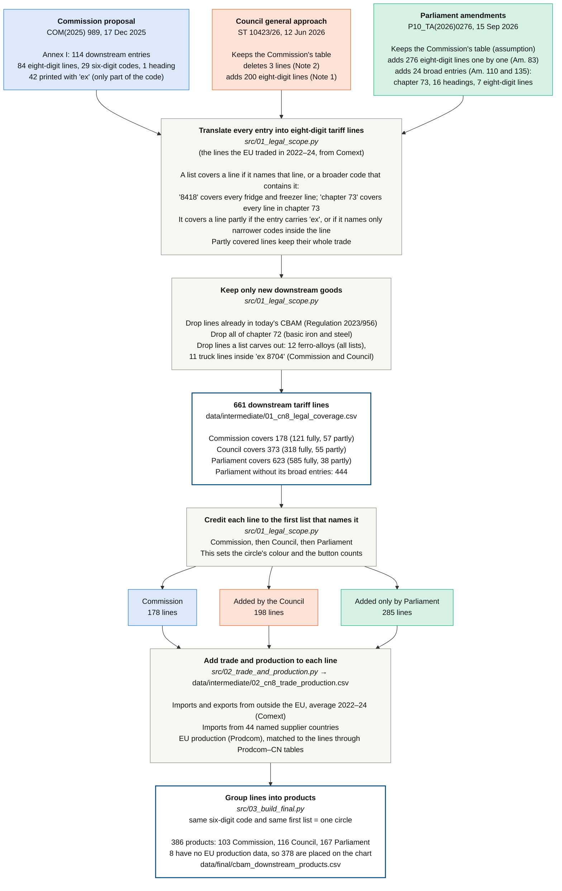

# CBAM downstream extension: data and interactive chart

Code and data behind the CER Insight *Europe's carbon border should stop where the carbon does* and its
interactive chart, *Does a broader CBAM mean better protection against carbon
leakage?* (subtitle: *Extending CBAM downstream: carbon-leakage risk and import
dependence, product by product*). Everything runs from the raw downloads to the
published chart, and the result is byte-for-byte identical to the published page.

## How it fits together

```
data/raw/                     legal lists (transcribed) and Eurostat downloads (as downloaded, gzipped)
  │  src/01_legal_scope.py         which 8-digit tariff lines each position covers
  ▼
data/intermediate/01_cn8_legal_coverage.csv           661 lines x Commission / Council / Parliament
  │  src/02_trade_and_production.py imports, suppliers, EU production for each line
  ▼
data/intermediate/02_cn8_trade_production.csv         661 lines: trade, production, market shares
data/intermediate/02_cn8_imports_by_partner.csv       661 lines x 44 supplier countries
  │  src/03_build_final.py          group lines into chart rows; supplier shares, CBAM charge, names
  ▼
data/final/cbam_downstream_products.csv               386 rows, one per circle on the chart
  │  src/04_build_chart.py          paste the data and the CER logo (chart/cer_logo.png) into chart/template.html
  │  src/05_headline_figures.py     the numbers quoted in the Insight
  ▼
docs/index.html (the interactive chart), docs/headline_figures.csv
```

Every assumption (carbon price, emission factors, metal content, cut-offs,
display groups, country names, one hand-filled product name) is in
`src/config.py`. Each script starts with a note saying what it reads, what it
writes and how.

## Run it

You need Python 3.10 or later. Open this folder in VS Code, then open a
terminal (Terminal → New Terminal). The commands below are for Windows
PowerShell; the Mac/Linux equivalents follow.

**1. Go to the project folder** (VS Code usually opens the terminal there already):

```
cd "C:\path\to\cbam-downstream"
```

**2. Create a virtual environment (first time only).** It goes outside the
project folder so OneDrive does not try to sync it:

```
python -m venv $HOME\.venvs\cbam
```

**3. Activate it (every new terminal).** `(cbam)` then appears at the start of the prompt:

```
& $HOME\.venvs\cbam\Scripts\Activate.ps1
```

If PowerShell says running scripts is disabled, run
`Set-ExecutionPolicy -Scope CurrentUser RemoteSigned` once, then try again.

**4. Install the packages (first time only, or when `requirements.txt` changes):**

```
python -m pip install -r requirements.txt
```

**5. Run the whole pipeline.** It takes about 15 seconds:

```
python run_all.py
```

If this stops with `ModuleNotFoundError: No module named 'pandas'`, the
environment is not active (no `(cbam)` at the start of the prompt): go back to
step 3, then run it again.

**6. Open the chart in your browser:**

```
start docs\index.html
```

**Only changed the chart's look (`chart/template.html`)?** Skip step 5 and
rebuild just the chart, then reopen it:

```
python src/04_build_chart.py
start docs\index.html
```

Any step can be run on its own in the same way, e.g. `python src/03_build_final.py`.

**Mac/Linux:** create the environment with `python3 -m venv ~/.venvs/cbam`, activate
it with `source ~/.venvs/cbam/bin/activate`, and open the chart with
`open docs/index.html` (Mac) or `xdg-open docs/index.html` (Linux). The other
commands are the same.

The chart is published with GitHub Pages from the `docs/` folder:
https://eliseviadere97.github.io/cbam-downstream/

## Check that it reproduces the published chart

After `python run_all.py`, `docs/index.html` has this SHA-256 checksum, the same
as the published chart (version of 10 November 2026):

```
09afd97defedddf5d547da75fa7159c34054a940fdaecd8ab339dbac56df0c85
```

Check with `sha256sum docs/index.html` (Linux, macOS) or
`Get-FileHash docs\index.html` (Windows PowerShell).

`docs/headline_figures.csv` holds the Insight's figures: imports covered of
€66bn, €139bn and €238bn a year; 0.23, 0.14 and 0.11 Mt of CO₂ per €bn on
the Commission's list and on what the Council and Parliament add; average
charges of 1.9%, 1.6% and 1.4%; €17.1bn of imports with both risks.

## From three lists to one dataset

The Commission, the Council and Parliament write their product lists in
different ways: some entries are single eight-digit tariff lines, others are
whole headings or chapters, and some cover only part of a code ("ex"). The
diagram shows how the code turns the three texts (top) into one dataset with
one row per product (bottom), and how many lines or products are left at each
stage. GitHub draws it from the text below.



## Method in brief

**Scope (step 1).** A list covers a tariff line if it prints the line, or a
broader code containing it (e.g. heading 8413), or, partly, narrower codes
inside it. "ex" entries count as partial cover but the whole line's trade is
counted. Lines already in today's CBAM and all of chapter 72 are dropped. The
Council's list is the Commission's, minus three deleted lines, plus 200 added
lines. Parliament's is assumed to keep the Commission's lines and to add 276
lines (Amendment 83) and broad entries (Amendments 110 and 135, e.g. all of
chapter 73). That gives 178, 373 and 623 lines; the figures usually quoted are
about 180, about 200 *added* by the Council, and 457 for Parliament (which does
not count its broad entries in full).

**Trade (step 2).** Comext extra-EU imports and exports, average of 2022–24.
Supplier shares use imports from 44 named countries.

**EU production (step 2).** Prodcom, matched to tariff lines through the 2025
Prodcom–CN correspondence, then the 2014 Magerman concordance, then the 2025
Prodcom release. Imports' share of the EU market = Prodcom imports ÷ (Prodcom
imports + EU production).

**Chart rows (step 3).** A six-digit HS code together with the position that
first lists its lines. The CBAM charge is metal content × emission factor ×
€82.32 ÷ import value per tonne, at full phase-in (steel 1.9 tCO₂/t, aluminium
1.55; metal content 1.0 for chapters 73 and 76, 0.79 otherwise). €82.32 is the
[price the Commission set for CBAM certificates](https://taxation-customs.ec.europa.eu/carbon-border-adjustment-mechanism/price-cbam-certificates_en)
for the third quarter of 2026.

**Chart cut-offs.** Leakage risk: charge of 1% or more. Dependence risk: imports
above a third of the EU market *and* one country above half of those imports.
They are fixed lines, not medians.

## The final dataset

`data/final/cbam_downstream_products.csv`

| Column | Meaning |
|---|---|
| map_order | Order of the row on the chart |
| hs6 | Six-digit HS code |
| product, product_group | Description (long ones end in "…") and display group |
| cn8_lines | Eight-digit tariff lines in the row |
| first_listed_by | Commission, else Council, else Parliament. Sets the colour |
| on_commission, on_council, on_parliament | 1 if that position's list includes the row |
| imports_eur_m | Extra-EU imports, € million a year, 2022–24. Circle size |
| main_supplier, main_supplier_share | Largest non-EU supplier and its share of extra-EU imports. Filled circle above 50% |
| china_share | China's share of extra-EU imports |
| import_share_eu_market | Imports ÷ (EU production + imports). **x-axis** |
| import_share_consumption | Imports ÷ (production − exports + imports), capped at 1; blank where undefined |
| main_supplier_share_market, main_supplier_share_consumption | Main supplier's share × the two import shares |
| exports_over_production | EU exports ÷ EU production |
| cbam_charge | CBAM charge as a share of the import price. **y-axis** |

Blank cells are missing values: 8 rows have no EU production data and are not
placed on the chart. The columns of the intermediate files are described in
`data/intermediate/README.md`.

## Known limits

- The emission factors and metal content are assumptions, not the CBAM default values.
- 57 lines covered only through "ex" entries are counted in full.
- Parliament's list is the widest reading of its text (623 lines).
- One product name (HS 850300, Parliament) is filled by hand in `src/config.py`; no source file describes it.
- HS 840734 has near-zero recorded EU production, giving an exports/production ratio of 7,310.

## Sources

See `data/raw/README.md` for each file, its origin and download date.
